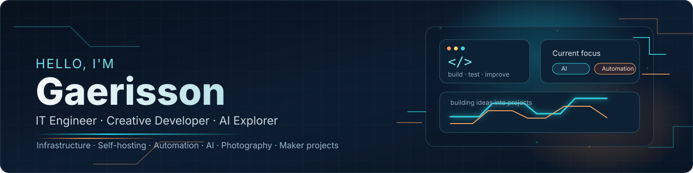
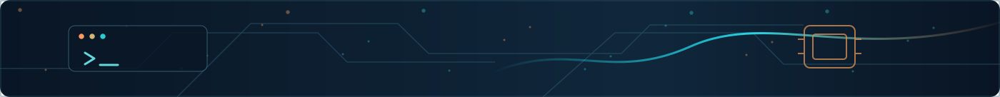
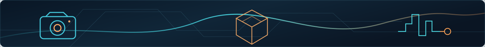

  

# Hey there, I'm Gaëtan! 👋

**IT Engineer · Creative Developer · AI Explorer**

🇫🇷 Based in France · Usually building something new

Welcome to my little corner of GitHub. I'm an IT engineer who enjoys making technology do interesting (and occasionally unexpected) things.

By day, I work with infrastructure, systems and all the challenges that come with keeping technology running. Outside of work, I'm usually **coding a new tool, experimenting in my homelab, exploring AI or creating something with my hands**.

I'm particularly interested in **AI-assisted development, automation and vibe coding** — not just generating code, but turning an idea into something useful, testing it, improving it and learning from the process.

> My approach: build it, break it, understand it, make it better.

---

## 🚀 Projects I'm building

A few highlights from my **public** repositories. I work on quite a few things at once, so there's usually another experiment underway.

### [AniPic](https://github.com/Gaerisson/AniPic) · Media tools for animal shelters
A workspace for organizing animal photos, preparing content, making videos and managing digital signage. Built around practical needs and day-to-day workflows.

`React` · `Fastify` · `SQLite` · `Docker`

### [Lumen](https://github.com/Gaerisson/Lumen) · A connected Windows desktop
A modular Windows companion bringing together Home Assistant information, desktop widgets, computer insights and useful everyday controls.

`Electron` · `Windows` · `Home Assistant`

### [RedBlade+](https://github.com/Gaerisson/redblade-aurora-openrgb) · Keyboard firmware & RGB Studio
Custom firmware and a Windows configuration tool for per-key lighting, onboard profiles, effects and shortcuts.

`Firmware` · `OpenRGB` · `Windows`

### [Sillora DJ](https://github.com/Gaerisson/Sillora-DJ) · DJ & live-audio workspace
A Windows audio application exploring dual-deck mixing, library management, live controls and remote operation.

`Audio` · `Desktop App` · `Web Remote`

**[→ Explore all my public repositories](https://github.com/Gaerisson?tab=repositories)**

---

## 🛠️ My toolbox

These are technologies I use, experiment with or enjoy learning about — not a claim that I've mastered them all.

**Languages & development**

**Infrastructure & self-hosting**

**Currently exploring**

---

## ⚙️ What keeps me curious

- **AI & development** — Building apps, bots, automation tools and experiments with language and voice models.
- **Homelabbing** — Virtual machines, containers, networking, self-hosted services and learning through hands-on infrastructure.
- **Smart home & electronics** — Home Assistant, hardware tinkering, Arduino and the occasional unnecessarily complicated DIY idea.
- **Photography** — Capturing moments, editing images and enjoying the creative side of technology.
- **3D printing & laser engraving** — Taking digital designs out of the screen and into the real world.

The fun is in connecting these interests. Sometimes a weekend project starts as an infrastructure problem and ends up involving a web app, an AI model and a 3D-printed part.

---

## 📊 GitHub activity

View GitHub stats and most-used repository languages

 

  
  

These images use a third-party service and may occasionally be unavailable. Language breakdown reflects repository code, not skill level.

---

## 🌐 Find me around

*Just a curious tech enthusiast building things, exploring ideas and enjoying the process.* ✨
